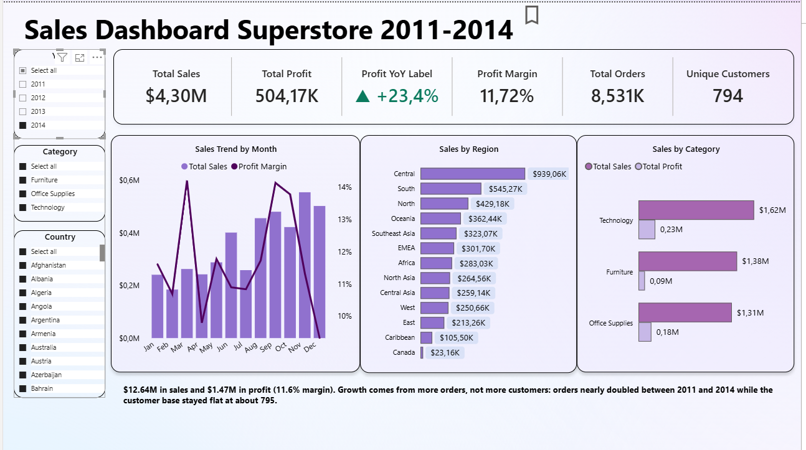
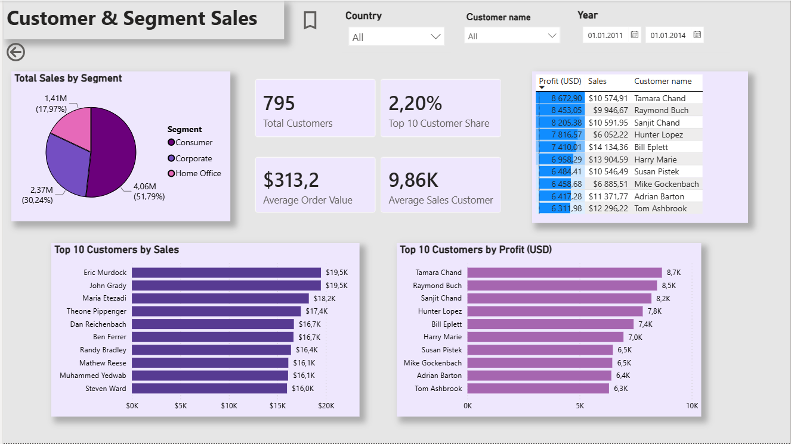
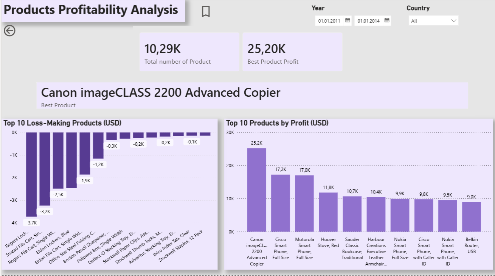

# Superstore Sales Dashboard in Power BI

## Project Overview

This project focuses on analyzing Superstore sales data to identify key business performance indicators, evaluate profitability, understand customer behavior, and discover opportunities for business optimization.

The dashboard was developed in Power BI to provide an interactive view of:

- Sales performance
- Profitability trends
- Customer segments
- Product performance
- Geographic analysis
- Loss-making areas

The goal of this project was to transform raw transactional data into actionable business insights.

---

# Business Questions

The analysis was designed to answer the following questions:

- What are the overall sales and profit performance metrics?
- Which product categories generate the highest revenue?
- Which products contribute the most profit?
- Which customer segments drive business growth?
- Are there products or countries causing profitability losses?

---

# Skills Demonstrated

This project demonstrates practical experience with:

- Data cleaning
- Data modeling
- Business intelligence reporting
- KPI development
- DAX calculations
- Data visualization
- Exploratory data analysis
- Business storytelling

---
# Dataset

**Dataset:** SuperStore Orders

The dataset contains transactional sales information including:

- Orders
- Customers
- Products
- Categories
- Countries
- Sales
- Profit
- Quantity
- Shipping information

---

# Tools & Technologies

- Power BI
- Power Query
- Advanced DAX
- SQL

---

# Data Preparation

Data cleaning and transformation were performed using Power Query.

Performed steps:

- Checked dataset for duplicate records
- Reviewed missing and blank values
- Converted incorrect data types
- Standardized numerical fields
- Prepared clean tables for reporting
- Loaded transformed data into Power BI

Updated data types:

- Sales
- Profit
- Quantity
- Shipping Cost

---

# Data Model

The dashboard uses a structured data model optimized for reporting and analysis.

Main analytical dimensions:

- Date
- Customer
- Product
- Category
- Geography

Fact data:

- Orders
- Sales
- Profit
- Quantity

---

# DAX Measures

Created custom DAX measures for KPI tracking and business analysis.

## Sales & Profit Metrics

- Total Sales
- Total Profit
- Profit Margin
- Average Sales per Customer
- Average Profit per Country
- Average Profit Value

## Customer Analytics

- Total Customers
- Customer Margin
- Top 10 Customer Sales
- Top 10 Customer Share

## Product Analytics

- Best Product
- Best Product Profit
- Loss-Making Products Count

## Geographic Analysis

- Top Sales Country
- Highest Profit Country

## Operational Metrics

- Total Orders
- Total Quantity
- Average Order Value

---

# Dashboard Pages

## 1. KPI&Trend

Provides a high-level view of company performance.

Features:

- KPI cards:
  - Total Sales
  - Total Profit
  - Profit YoY
  - Profit Margin
  - Total Orders
  - Unique Customers

- Sales Trend by Month
- Sales by Region
- Sales&Profit by Category

Filters:

- Year
- Country
- Category

### Key Insights

- Total Sales reached: **$12.64M**
- Total Profit reached: **$1.47M**
- Profit YoY: The highest growth was recorded in 2013 compared to 2012 amounting to **32.9%**
- Profit Margin: **11.62%**
- Total Orders reached: **25 035**
- Unique Customers reached: **795**
- Technology and Furniture generated the largest sales contribution
- Growth comes from more orders, not more customers: orders nearly doubled between 2011 and 2014 while the customer base stayed flat at about 795. 

---

## 2. Country Performance Analysis

Analyzes performance across different countries.

Features:

- KPI cards:
  - Countries Count
  - AVG Sales per Customer
  - Loss Countries
  - Top Profit Country
  - Profit of Top Country

- Top 5 Countries by Total Profit
- Top 5 Countries by Sales per Customer
- Top 5 Countries with Lowest Total Profit
- Top 5 Countries with Lowest Sales per Customer
- Total Sales by Country (map)

Filters:

- Year
- Category

### Key Insights

- The United States leads on both sales ($2.30M) and profit ($286K).
- The USA also has the highest sales per customer ($2,897), more than three times the $805 average. 
- 29 countries are loss-making.
- The largest absolute losses are Turkey (−$98K), Nigeria (−$81K) and the Netherlands (−$41K), which together outweigh the profit of many mid-sized markets.

---

## 3. Customer & Segment Analysis

Focuses on customer behavior and segment performance.

Features:

- Total customers
- Average order value
- Top customers by sales
- Top customers by profit
- Segment contribution

Filters:

- Country
- Customer
- Year

### Key Insights

- Total customer base: **795 customers**
- Top 10 customers contribute **2.20%** of total sales
- Consumer segment generates the highest share of revenue (**51.79%**)
- Top customers include:
  - Tamara Chand
  - Raymond Buch
  - Sanjit Chand

- Average order value: **$313.2**

---

## 4. Product Profitability Analysis

Analyzes product-level performance.

Features:

- Best products by profit
- Loss-making products
- Product profitability ranking
- Product filters
  

### Key Insights

- Inventory contains more than **10K products**
- Best performing product:
  **Canon imageCLASS 2200 Advanced Copier**

- Highest single product profit:
  **$25.20K**

- Technology products generate the strongest profits
- Some products create significant losses and require pricing or inventory review
  
---

# Business Recommendations

Based on the analysis:

- Focus on high-margin technology products
- Review pricing strategies for loss-making products
- Investigate low-profit countries
- Develop retention strategies for valuable customers
- Optimize product portfolio based on profitability

---

# Future Improvements

Possible extensions:

- Add sales forecasting
- Build customer segmentation model
- Create automated data refresh pipeline
- Add SQL data extraction layer
- Include customer lifetime value analysis

---

# Author
Khrystyna Fesechko
