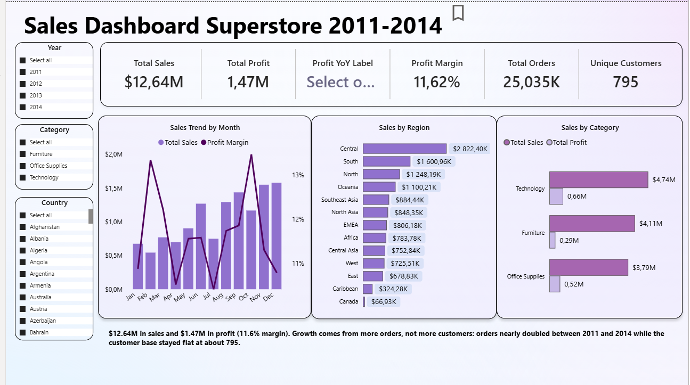
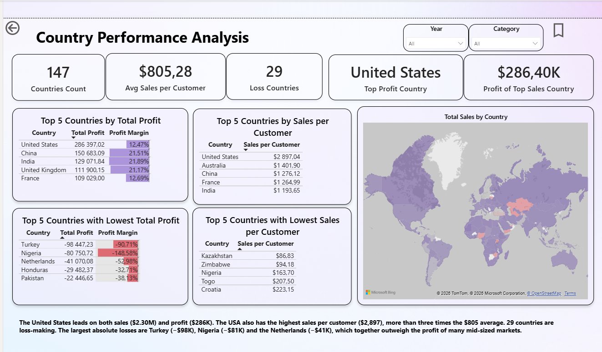
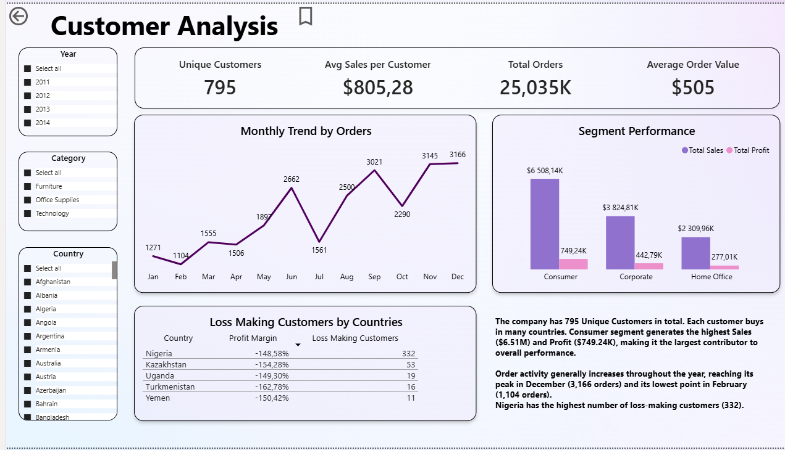
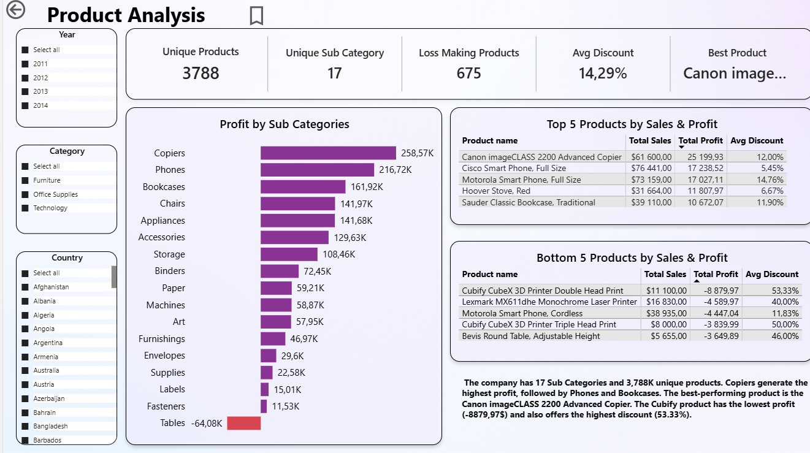

# Superstore Sales Dashboard in Power BI

## Project Overview

This project focuses on analyzing Superstore sales data to identify key business performance indicators, evaluate profitability, understand customer behavior, and discover opportunities for business optimization.

The report provides a view of:

- Sales performance
- Profitability and year-over-year profit change
- Customer segments
- Product performance
- Geographic analysis
- Loss-making areas (countries, products, sub-categories)

---

# Business Questions

The analysis was designed to answer the following questions:

- What are the overall sales and profit performance metrics?
- Which product categories generate the highest sales and the highest profit?
- Which products and sub-categories contribute the most profit?
- Which customer segments drive business growth?
- Which countries and products cause profitability losses?
- How do discounts relate to weak product profitability?

---

# Skills Demonstrated

This project demonstrates practical experience with:

- Data cleaning and data quality troubleshooting
- Data modeling (star schema)
- Business intelligence reporting
- KPI development
- DAX calculations
- Data visualization and dashboard design
- Drill-through navigation
- Exploratory data analysis
- Business storytelling

---
# Dataset

**Dataset:** SuperStore Orders

- 51,290 order lines, 2011–2014
- 25,035 unique order IDs, 795 customers, 147 countries, 3,788 product names, 17 sub-categories

Fields include:

- Orders (order ID, order and ship dates, ship mode, order priority)
- Customers (name, segment)
- Products (ID, name, category, sub-category)
- Geography (country, state, market, region)
- Sales, Profit, Quantity, Discount, Shipping cost
---

# Tools & Technologies

- Power BI
- Power Query (M)
- Advanced DAX
- SQL

---

# Data Preparation

Data cleaning and transformation were performed in Power Query.

- Reviewed the dataset for missing values (none found)
- Converted incorrect data types and created numeric versions of Sales, Profit, Quantity, Discount and Shipping Cost
- Converted date columns to the Date type
- Validated key totals against the source file (sales, profit, orders, customers)
- Built a staging query (load disabled) and generated dimension tables from it
- Loaded the transformed tables into Power BI

**Data quality issue found and fixed:** Sales values of 1,000 or more were stored as text with a thousands separator (for example `1,648`). The Ukrainian locale read the comma as a decimal separator, so total sales showed **$7.84M instead of the correct $12.64M**, and margins by country were distorted. The fix removes the separator and converts the column with an English (US) locale.

---

# Data Model

The report uses a star schema optimized for reporting and analysis.

**Fact table**

- `SuperStoreOrders`: sales, profit, quantity, discount, shipping cost, order ID, dates, ship mode, order priority and keys to the dimensions

**Dimensions**

- `Calendar`: date table (2011–2014)
- `Dim_Customer`: customer, segment
- `Dim_Product`: product ID, product name, category, sub-category
- `Dim_Geography`: country, state, market, region

Relationships are one-to-many with single-direction filtering. Dimension keys are generated surrogate keys, because the source IDs are not unique: some product IDs map to several product names, and some countries map to several regions.
---

# DAX Measures

Custom DAX measures were created for KPI tracking and business analysis.

### Sales & Profit Metrics

- Total Sales
- Total Profit
- Profit Margin
- Profit YoY (current year vs previous year, with dynamic label and color)

### Customer Analytics

- Total Customers
- Avg Sales per Customer
- Customer Margin
- Loss Customers Count
- Top 10 Customers Sales
- Top 10 Customer Share

### Product Analytics

- Best Product
- Best Product Profit
- Loss-Making Products Count
- Avg Discount

### Geographic Analysis

- Countries Count
- Loss Countries
- Top Sales Country
- Highest Profit Country
- Profit of Top Sales Country

### Operational Metrics

- Total Orders
- Total Quantity
- Average Order Value

---

# Dashboard Pages

## 1. KPI&Trend

Provides a high-level view of company performance.

Features:

- KPI cards:
  - Total Sales
  - Total Profit
  - Profit YoY
  - Profit Margin
  - Total Orders
  - Unique Customers

- Sales Trend by Month
- Sales by Region
- Sales&Profit by Category

Filters:

- Year
- Country
- Category

### Key Insights

- Total Sales reached: **$12.64M**
- Total Profit reached: **$1.47M**
- Profit YoY: The highest growth was recorded in 2013 compared to 2012 amounting to **32.9%**
- Profit Margin: **11.62%**
- Total Orders reached: **25 035**
- Unique Customers reached: **795**
- Technology and Furniture generated the largest sales contribution
- Growth comes from more orders, not more customers: orders nearly doubled between 2011 and 2014 while the customer base stayed flat at about 795. 

---

## 2. Country Performance Analysis

Analyzes performance across different countries.

Features:

- KPI cards:
  - Total Sales
  - Total Profit
  - Total Countries
  - Sales per Customer
  - Highest Profit Country

- Top 5 Sales Countries & Profit 
- Bottom 5 Sales Countries & Profit 
- Global Sales & Profitability Overview (map)

Filters:

- Year
- Category
- Country

### Key Insights

- The United States leads on both sales ($2.30M) and profit ($286K).
- The USA also has the highest sales per customer ($2,897), more than three times the $805 average. 
- The largest absolute losses are Turkey (−$98K), Nigeria (−$81K) and the Netherlands (−$41K), which together outweigh the profit of many mid-sized markets.
- Overall, while the United States remains the main profit driver, the negative performance of several markets may offset gains from profitable countries.

---

## 3. Customer Analysis

Focuses on customer behavior and segment performance.

Features:
- KPI cards:
- Unique Customers
- Average Sales per Customer
- Total Orders
- Average Order Value

- Monthly Trend by Orders
- Segment Performance
- Loss Making Customers by Countries

Filters:

- Country
- Customer
- Year

### Key Insights

- The company has 795 Unique Customers in total. Each customer buys in many countries.
- Consumer segment generates the highest Sales ($6.51M) and Profit ($749.24K), making it the largest contributor to overall performance.
- Order activity generally increases throughout the year, reaching its peak in December (3,166 orders) and its lowest point in February (1,104 orders).
- Nigeria has the highest number of loss-making customers (332).

---

## 4. Product Profitability Analysis

Analyzes product-level performance.

Features:

- KPI cards:
- Unique Products
- Unique Sub Category
- Loss Making Products
- Average Discount
- Best Product

- Profit by Sub Categories
- Top 5 Products by Sales & Profit
- Bottom 5 Products by Sales & Profit

Filters:

- Country
- Customer
- Year
  

### Key Insights

- The company has 17 Sub Categories and 3,788K unique products.
- Copiers generate the highest profit, followed by Phones and Bookcases. 
- The best-performing product is the Canon imageCLASS 2200 Advanced Copier.
- The Cubify product has the lowest profit (-8879,97$) and also offers the highest discount (53.33%).

---

## Notes and Limitations

- Customers in this dataset buy in many countries (about 20 on average), so customer counts by country overlap and do not add up to the 795 total.
- `order_id` is not unique per order in the source data, so Total Orders counts distinct order IDs.
- Orders by month are aggregated across all years, so the monthly charts show seasonality rather than a year-over-year trend.

# Business Recommendations

- Prioritize Technology and Office Supplies, and fix Furniture profitability. Technology earns $0.66M profit on $4.74M sales and Office Supplies $0.52M on $3.79M (about 14% margin each), while Furniture earns only $0.29M on $4.11M (about 7%)
- Cap discounts on low-profit products. Four of the five lowest-profit products carry average discounts of 40–53% (for example, Cubify CubeX 3D Printer Double Head Print: −$8.9K at 53.3%), versus 5–15% for the five most profitable products 
- Review pricing and range in the Tables sub-category. Tables is the only sub-category with a loss (−$64.1K), while Copiers ($258.6K) and Phones ($216.7K) lead
- Investigate low-profit countries. Turkey (−$98K), Nigeria (−$81K), the Netherlands (−$41K), Honduras (−$29K) and Pakistan (−$22K) have negative profit; review pricing, discounts and logistics costs there
- Protect the core markets. The United States generates $286K profit and the highest sales per customer ($2,897); China, India, the United Kingdom and France follow 
- Keep the Consumer segment as the volume core. Consumer is the largest segment ($6.51M sales, $749K profit); Home Office is the smallest but has a slightly higher margin 
- Plan around seasonality. Orders peak in December (3,166) and are lowest in February (1,104); align inventory, staffing and promotions 
---

# Author
Khrystyna Fesechko
